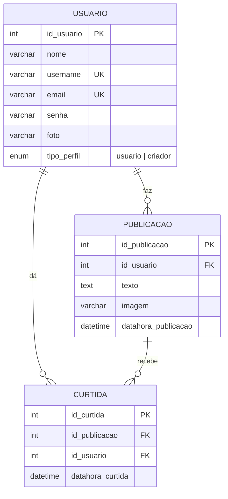

# SENAI Conecta

Rede social web simples, feita como atividade prática do SENAI. Usuários se cadastram, fazem login, veem o feed de publicações, curtem posts, pesquisam pessoas pelo `@username` e abrem a página de perfil de cada uma. Quem tem perfil **criador** também publica textos e imagens.

> Este README também serve como **guia de estudo**: explica o que cada parte faz, como as peças se conectam e como refazer o projeto do zero.

---

## Sumário

1. [Funcionalidades](#1-funcionalidades)
2. [Tecnologias](#2-tecnologias)
3. [Estrutura de pastas](#3-estrutura-de-pastas)
4. [Como instalar e rodar](#4-como-instalar-e-rodar)
5. [Contas de teste](#5-contas-de-teste)
6. [Banco de dados](#6-banco-de-dados)
7. [API (rotas)](#7-api-rotas)
8. [Como o sistema funciona (fluxos)](#8-como-o-sistema-funciona-fluxos)
9. [Segurança](#9-segurança)
10. [Guia de estudo](#10-guia-de-estudo)
11. [Como refazer o projeto do zero](#11-como-refazer-o-projeto-do-zero)
12. [Onde mexer para...](#12-onde-mexer-para)
13. [Solução de problemas](#13-solução-de-problemas)
14. [Melhorias futuras](#14-melhorias-futuras)

---

## 1. Funcionalidades

| Recurso | Visitante | Usuário | Criador |
|---|:---:|:---:|:---:|
| Ver o feed e os perfis | ✅ | ✅ | ✅ |
| Pesquisar usuários por `@username` | ✅ | ✅ | ✅ |
| Curtir / descurtir publicações | ❌ (pede login) | ✅ | ✅ |
| Publicar texto e imagem | ❌ | ❌ | ✅ |
| Excluir a **própria** publicação | ❌ | ❌ | ✅ |
| Cadastrar-se e fazer login | ✅ | — | — |

**Página de perfil** (`perfil.html?u=username`): foto (ou inicial do nome, se não houver foto), nome, `@username`, tipo de perfil, quantidade de publicações, curtidas recebidas e a lista das publicações da pessoa. Abre clicando no nome/foto do autor no feed, em um resultado da busca ou no seu próprio `@username` no cabeçalho.

**Busca**: digite parte do username (com ou sem `@`). Aparece uma lista de até 10 pessoas; se ninguém for encontrado, a mensagem *"Nenhum usuário encontrado"* é exibida.

---

## 2. Tecnologias

| Camada | Tecnologia | Para quê |
|---|---|---|
| Front-end | HTML5, CSS3, JavaScript (sem frameworks) | Telas e interação |
| Back-end | PHP 8 (API REST em um único `index.php`) | Regras de negócio e rotas |
| Banco | MariaDB / MySQL com PDO | Armazenar dados |
| Autenticação | JWT (HS256, feito à mão) | Identificar quem está logado |
| Servidor | Apache (XAMPP) com `mod_rewrite` | Rodar PHP e reescrever URLs |

---

## 3. Estrutura de pastas

```
senai_conecta/
├── README.md
├── backend/
│   ├── .htaccess                 # manda toda requisição para o index.php + repassa o token
│   ├── index.php                 # API: rotas, regras e respostas JSON
│   ├── config/
│   │   └── database.php          # conexão PDO com o banco
│   ├── helpers/
│   │   └── jwt_helper.php        # gera e valida o token JWT
│   └── uploads/                  # fotos e imagens enviadas (precisa existir)
├── db/
│   ├── senai_conecta.sql         # cria o banco, as tabelas e os usuários de teste
│   └── usuario.csv               # os mesmos usuários de teste, em CSV
└── frontend/
    ├── index.html                # página inicial (feed)
    ├── perfil.html               # página de perfil
    ├── css/
    │   └── style.css             # todo o visual
    └── js/
        ├── api.js                # apiFetch(): fala com a API e envia o token
        ├── posts.js              # desenha posts, avatar, curtir e excluir
        ├── auth.js               # login, cadastro, sair, cabeçalho do usuário
        ├── search.js             # barra de pesquisa
        ├── app.js                # lógica da página inicial
        └── perfil.js             # lógica da página de perfil
```

**Ordem dos `<script>` nos HTMLs (importa!):** `api.js` → `posts.js` → `auth.js` → `search.js` → `app.js` (ou `perfil.js`). Cada arquivo usa funções dos anteriores.

---

## 4. Como instalar e rodar

### Pré-requisitos
- [XAMPP](https://www.apachefriends.org/) (Apache + MariaDB + PHP 8)

### Passo a passo

1. **Copie o projeto** para `C:\xampp\htdocs\` de modo que fique `C:\xampp\htdocs\senai_conecta\` (com `backend` e `frontend` dentro).
2. **Inicie** o *Apache* e o *MySQL* no painel do XAMPP.
3. **Crie o banco:** abra `http://localhost/phpmyadmin` → aba **Importar** → escolha `db/senai_conecta.sql` → **Importar**. O arquivo já cria as tabelas e insere os usuários de teste (não precisa importar o CSV junto).
4. **Confira a pasta `backend/uploads/`**: ela precisa existir e as fotos dos usuários de teste (`criador1.jpg`, `usuario1.jpg`...) ficam nela. Sem as fotos, o sistema mostra a inicial do nome no lugar.
5. **Abra o site:** `http://localhost:8080/senai_conecta/frontend/index.html`
   (se o seu Apache usa a porta 80, troque `:8080` por nada).

### Configurações que podem precisar de ajuste

| O quê | Onde | Padrão |
|---|---|---|
| Usuário/senha do banco | `backend/config/database.php` | `root` / vazio |
| Nome do banco | `backend/config/database.php` | `senai_conecta` |
| Endereço da API | **automático** (`frontend/js/api.js` descobre pela URL) | — |
| Segredo do JWT | `backend/helpers/jwt_helper.php` | `SENAI_movendo_A_industria_2026` |

> O nome da pasta no `htdocs` pode ser qualquer um (ex.: `Senai-Conecta`): o front e o back descobrem o caminho sozinhos.

---

## 5. Contas de teste

Senha de **todas**: `123456`

| E-mail | Username | Tipo |
|---|---|---|
| criador1@gmail.com | `criador_1` | criador |
| criador2@gmail.com | `criador_2` | criador |
| criador3@gmail.com | `criador_3` | criador |
| usuario1@gmail.com | `usuario_1` | usuário |
| usuario2@gmail.com | `usuario_2` | usuário |
| usuario3@gmail.com | `usuario_3` | usuário |

Quem se cadastra pelo formulário entra sempre como **usuário** (o tipo `criador` é definido direto no banco).

**Roteiro de teste rápido**
1. Entre como `criador1` → o formulário "Nova publicação" aparece → publique um texto com imagem.
2. Saia e entre como `usuario1` → o formulário **não** aparece, mas dá para curtir.
3. Clique no nome do autor de um post → abre o perfil com as contagens.
4. Pesquise `criador` na barra → lista de resultados. Pesquise `xyz` → mensagem de "nenhum usuário encontrado".

---

## 6. Banco de dados

### Diagrama



### Pontos importantes
- **`username` e `email` são `UNIQUE`**: o banco impede duplicados.
- **`tipo_perfil` é um `ENUM`**: só aceita `'usuario'` ou `'criador'`.
- **`curtida` é a tabela de ligação** (relação N:N entre usuário e publicação). A chave `UNIQUE (id_publicacao, id_usuario)` impede curtir duas vezes o mesmo post.
- **`ON DELETE CASCADE`**: apagar um usuário apaga suas publicações e curtidas; apagar uma publicação apaga suas curtidas.
- Imagens **não ficam no banco**: só o nome do arquivo é salvo; o arquivo fica em `backend/uploads/`.

### Consultas úteis (para entender e testar no phpMyAdmin)

```sql
-- Quantas publicações cada usuário fez
SELECT u.username, COUNT(p.id_publicacao) AS total
FROM usuario u LEFT JOIN publicacao p ON p.id_usuario = u.id_usuario
GROUP BY u.id_usuario;

-- Curtidas recebidas por usuário (a conta do perfil)
SELECT u.username, COUNT(c.id_curtida) AS curtidas_recebidas
FROM usuario u
LEFT JOIN publicacao p ON p.id_usuario = u.id_usuario
LEFT JOIN curtida c ON c.id_publicacao = p.id_publicacao
GROUP BY u.id_usuario;

-- Busca por username (a mesma ideia da barra de pesquisa)
SELECT * FROM usuario WHERE username LIKE '%criador%';

-- Promover um usuário a criador
UPDATE usuario SET tipo_perfil = 'criador' WHERE username = 'usuario_1';
```

---

## 7. API (rotas)

Base: `http://localhost:8080/senai_conecta/backend`. Todas as respostas são JSON.

Rotas protegidas exigem o cabeçalho `Authorization: Bearer <token>`.

| Método | Rota | Login? | Descrição |
|---|---|:---:|---|
| POST | `/login` | não | Recebe `{email, senha}` e devolve `{token, usuario}` |
| POST | `/cadastro` | não | Cria usuário (`nome, username, email, senha, foto` em FormData) |
| GET | `/publicacoes` | não | Feed com todas as publicações |
| POST | `/publicacoes` | **sim (criador)** | Cria publicação (`texto`, `imagem` em FormData) |
| DELETE | `/publicacoes/{id}` | **sim (dono)** | Exclui a própria publicação |
| POST | `/curtir` | sim | Alterna a curtida de `{id_publicacao}` |
| GET | `/usuarios?busca=texto` | não | Pesquisa por username (até 10 resultados) |
| GET | `/usuarios/{username}` | não | Perfil + estatísticas + publicações |

### Códigos de status usados

| Código | Significado | Onde aparece |
|---|---|---|
| 200 | OK | respostas de sucesso |
| 201 | Criado | cadastro e nova publicação |
| 400 | Requisição inválida | campos vazios, username inválido, imagem inválida |
| 401 | Não autenticado | sem token / token inválido ou expirado / login errado |
| 403 | Sem permissão | usuário tentando publicar; excluir post de outro |
| 404 | Não encontrado | rota ou usuário inexistente |
| 409 | Conflito | username ou e-mail já cadastrados |
| 500 | Erro interno | falha na conexão com o banco |

### Exemplos

**Login**
```http
POST /login
Content-Type: application/json

{ "email": "criador1@gmail.com", "senha": "123456" }
```
```json
{
  "token": "eyJ0eXAiOiJKV1QiLCJhbGciOiJIUzI1NiJ9.eyJpZF91c3VhcmlvIjoi...",
  "usuario": { "id_usuario": 1, "nome": "criador1", "username": "criador_1",
               "foto": "criador1.jpg", "tipo_perfil": "criador" }
}
```

**Perfil** (`GET /usuarios/criador_1`)
```json
{
  "id_usuario": 1, "nome": "criador1", "username": "criador_1",
  "foto": "criador1.jpg", "tipo_perfil": "criador",
  "total_publicacoes": 2, "total_curtidas_recebidas": 1,
  "publicacoes": [ { "id_publicacao": 5, "texto": "teste", "total_curtidas": 1, "...": "..." } ]
}
```

**Erro de permissão** (usuário comum tentando publicar)
```json
{ "erro": "Apenas usuários do tipo criador podem publicar." }
```
com status `403`.

---

## 8. Como o sistema funciona (fluxos)

### 8.1 Arquitetura

```
 Navegador (HTML + CSS + JS)                    Servidor (Apache + PHP)              Banco
 ┌──────────────────────────┐   fetch (JSON)   ┌──────────────────────┐   PDO   ┌──────────┐
 │ index.html / perfil.html │ ───────────────► │ backend/index.php    │ ──────► │ MariaDB  │
 │ js/*.js                  │ ◄─────────────── │ (rotas + regras)     │ ◄────── │          │
 └──────────────────────────┘   resposta JSON  └──────────────────────┘         └──────────┘
```

O front **não** acessa o banco. Ele só conversa com a API; a API aplica as regras (quem pode o quê) e fala com o banco.

### 8.2 Como o `.htaccess` e as rotas funcionam
O `.htaccess` manda toda URL que não é um arquivo real (ex.: `/backend/publicacoes`) para o `index.php`. O `index.php` lê o caminho (`parse_url`), tira o prefixo da pasta e compara com cada rota (`if ($uri === '/login' && $method === 'POST')`). A primeira que casar responde e executa `exit`. Se nenhuma casar: **404 "Rota não encontrada"**.

### 8.3 Cadastro
1. Formulário → `FormData` (porque pode ter foto) → `POST /cadastro`.
2. A API valida campos e formato do username, confere se username/e-mail já existem (409), salva a foto em `uploads/` com nome único (`uniqid()`) e faz o `INSERT`.

### 8.4 Login e token JWT
1. `POST /login` com e-mail e senha. A API busca o usuário pelo e-mail e compara a senha.
2. Se bater, gera um **JWT** com `id_usuario`, `username`, `nome`, `tipo_perfil` e `exp` (validade de 8 horas).
3. O front guarda `token` e `usuario` no `localStorage`.
4. Em **toda** chamada, `apiFetch()` envia `Authorization: Bearer <token>`.
5. A API chama `getAuthenticatedUser()` → `JWTHelper::decode()`: recalcula a assinatura e confere; se estiver adulterado ou vencido, devolve `null` (→ 401).

**Anatomia do JWT:** `header.payload.assinatura`, cada parte em Base64URL. A assinatura é `HMAC-SHA256(header.payload, segredo)`. O payload é **legível por qualquer um** (não é criptografia): por isso nunca se coloca senha nele.

### 8.5 Feed e curtidas
`GET /publicacoes` roda uma consulta com `JOIN` (autor), `LEFT JOIN curtida` e `GROUP BY`, trazendo para cada post o `total_curtidas` e se o usuário logado já curtiu (`curtido_pelo_usuario`). O front desenha tudo com `renderPost()`.

`POST /curtir` funciona como um interruptor: se já existe curtida do usuário naquele post, **apaga**; se não existe, **insere**. Depois o front chama `reloadPage()` e o contador atualiza.

### 8.6 Publicar (somente criador)
A API faz **duas** verificações: (1) está logado? (401) e (2) é criador? (403), conferindo o `tipo_perfil` **no banco**, não só no token. O autor é sempre o `id_usuario` do token, nunca um valor enviado pelo formulário.

> O front também esconde o formulário de quem não é criador (`checkAuth()` em `auth.js`), mas isso é só conforto visual. **A regra que vale é a do back-end.**

### 8.7 Excluir
`DELETE /publicacoes/{id}` executa `DELETE ... WHERE id_publicacao = ? AND id_usuario = ?`. O `AND id_usuario` garante que só o dono apaga. Se nenhuma linha foi afetada (`rowCount() == 0`), responde 403.

### 8.8 Perfil
`perfil.html?u=criador_1` → `perfil.js` lê o `u` da URL → `GET /usuarios/criador_1` → a API devolve dados, `total_publicacoes` (`COUNT` em `publicacao`), `total_curtidas_recebidas` (`COUNT` em `curtida` com `JOIN` em `publicacao` filtrando pelo dono) e a lista de publicações.

### 8.9 Busca
`search.js` espera 300 ms depois da última tecla (*debounce*), chama `GET /usuarios?busca=texto` e a API responde com `WHERE username LIKE '%texto%' LIMIT 10`. Lista vazia → mensagem informativa. Um contador (`lastRequest`) descarta respostas antigas se você digitar rápido.

### 8.10 Por que existe `reloadPage()`?
Curtir, excluir, entrar e sair precisam atualizar a tela, mas cada página atualiza algo diferente. Então `posts.js` e `auth.js` apenas chamam `reloadPage()`, e **cada página define a sua**: `app.js` recarrega o feed, `perfil.js` recarrega o perfil.

---

## 9. Segurança

### Já aplicado no projeto

| Risco | Proteção | Onde |
|---|---|---|
| **SQL Injection** | *Prepared statements* (`?` e `:nome`): o valor nunca é colado no SQL | todo o `index.php` |
| **XSS** (injeção de script) | `escapeHtml()` em todo texto de usuário que vai para `innerHTML` | `posts.js` |
| Acesso sem login | JWT validado a cada rota protegida | `getAuthenticatedUser()` |
| Falsificar o token | Assinatura HMAC-SHA256 + `hash_equals` | `jwt_helper.php` |
| Token eterno | Campo `exp` (8 h) | `jwt_helper.php` / `/login` |
| Publicar sem permissão | Checagem de `tipo_perfil` no banco (403) | `POST /publicacoes` |
| Apagar post de outro | `WHERE ... AND id_usuario = ?` | `DELETE /publicacoes/{id}` |
| Upload perigoso | Só aceita `jpg, jpeg, png, gif, webp`; nome gerado com `uniqid()` | `saveUpload()` |
| Username malformado | Regex `^[A-Za-z0-9_.\-]{3,50}$` | `/cadastro` |
| Enviar duas vezes | Botão desabilitado + trava no envio | `app.js` |

### Limitações conscientes (bom saber explicar)
- **Senha em texto puro**: simplificação do exercício (os dados de teste do CSV são assim). O correto: `password_hash()` ao cadastrar e `password_verify()` no login.
- **CORS aberto (`*`)** e **segredo do JWT no código**: aceitável para estudo; em produção, restringir a origem e usar variável de ambiente.
- **Token no `localStorage`**: simples, mas fica exposto se houver XSS. Alternativa: cookie `HttpOnly`.

---

## 10. Guia de estudo

### 10.1 Conceitos que o projeto usa (e o que dizer sobre cada um)

| Conceito | Resumo |
|---|---|
| **API REST** | Servidor que expõe recursos por URLs e usa os verbos HTTP: GET (ler), POST (criar), DELETE (apagar), PUT/PATCH (alterar). Responde JSON. |
| **Cliente × servidor** | O front (navegador) pede; o back (PHP) decide e responde. Regra de segurança fica **sempre** no servidor. |
| **JSON** | Formato de texto para trocar dados: `json_encode`/`json_decode` (PHP), `JSON.stringify`/`JSON.parse` (JS). |
| **JWT** | Token assinado que prova quem é o usuário sem guardar sessão no servidor (*stateless*). |
| **Autenticação × autorização** | Autenticação = *quem é você* (login, 401). Autorização = *o que você pode fazer* (perfil criador, 403). |
| **PDO + prepared statements** | Acesso ao banco com parâmetros separados do SQL → evita SQL Injection. |
| **JOIN / LEFT JOIN** | Combina tabelas. `LEFT JOIN` mantém linhas sem correspondência (post sem curtidas aparece com 0). |
| **GROUP BY + COUNT** | Agrupa linhas e conta (curtidas por publicação). |
| **Chave primária / estrangeira** | PK identifica a linha; FK liga tabelas e garante integridade. |
| **ON DELETE CASCADE** | Apagar o "pai" apaga os "filhos" automaticamente. |
| **UNIQUE** | Impede valores repetidos (username, e-mail, curtida duplicada). |
| **Relação 1:N e N:N** | Usuário→publicações é 1:N. Usuário↔publicação por curtida é N:N (tabela de ligação). |
| **CORS** | Regra do navegador sobre chamar APIs de outra origem; a API libera com `Access-Control-Allow-*`. |
| **`fetch` + `async/await`** | Requisição assíncrona sem travar a página; `await` espera a resposta. |
| **`localStorage`** | Armazenamento do navegador (texto) que persiste ao fechar a aba. |
| **`FormData`** | Envia formulário com arquivos (multipart). Em PHP chega em `$_POST` e `$_FILES`. |
| **DOM** | Árvore do HTML que o JS altera (`getElementById`, `innerHTML`, `classList`). |
| **Eventos** | `submit`, `click`, `input`, `DOMContentLoaded`; `e.preventDefault()` cancela o comportamento padrão. |
| **Debounce** | Esperar o usuário parar de digitar antes de chamar a API. |
| **XSS** | Injeção de script via texto do usuário; combate-se escapando o HTML. |
| **`mod_rewrite` / `.htaccess`** | Reescreve URLs para um único ponto de entrada (`index.php`). |

### 10.2 Perguntas que podem aparecer (com respostas curtas)

1. **Por que usar `prepare` em vez de concatenar a variável no SQL?** Para o valor ser tratado só como dado, nunca como código SQL → evita SQL Injection.
2. **Qual a diferença entre 401 e 403?** 401: não está autenticado (sem login/token inválido). 403: está autenticado, mas não tem permissão.
3. **Por que conferir `tipo_perfil` no back-end se o front já esconde o formulário?** Porque qualquer pessoa pode chamar a API direto (Postman, console). Esconder no front não protege nada.
4. **O que tem dentro de um JWT e por que ele é seguro?** Header, payload e assinatura. Ninguém altera o payload sem invalidar a assinatura, pois não conhece o segredo.
5. **Dá para guardar a senha no JWT?** Não: o payload é só Base64, qualquer um lê.
6. **Para que serve o `LEFT JOIN` na consulta do feed?** Para trazer também publicações que ainda não têm curtidas.
7. **Como evitamos curtir duas vezes?** `UNIQUE (id_publicacao, id_usuario)` no banco + a rota verifica se a curtida existe antes de inserir.
8. **Por que o `DELETE` tem `AND id_usuario = ?`?** Para só o dono conseguir apagar o próprio post.
9. **Para que serve o `escapeHtml`?** Evitar XSS: transforma `<` e `>` em texto, para o navegador não executar scripts digitados por usuários.
10. **Por que `FormData` e não JSON no cadastro e na publicação?** Porque enviam arquivo (foto/imagem), e JSON não carrega arquivos.
11. **Qual a diferença entre `localStorage` e `sessionStorage`?** O primeiro persiste ao fechar o navegador; o segundo dura só enquanto a aba estiver aberta.
12. **O que faz `e.preventDefault()` no submit?** Impede o envio tradicional do formulário (que recarrega a página) para usarmos `fetch`.
13. **Por que a API responde 409 no cadastro duplicado?** 409 = conflito: o recurso (username/e-mail) já existe.
14. **Para que serve o `ON DELETE CASCADE`?** Manter a integridade: ao apagar um usuário, não sobram publicações órfãs.

---

## 11. Como refazer o projeto do zero

Siga esta ordem; cada etapa deixa algo funcionando para testar.

1. **Banco** — crie `senai_conecta`, as tabelas `usuario`, `publicacao`, `curtida` (veja `db/senai_conecta.sql`) e insira os usuários de teste.
2. **Conexão** — `config/database.php` com PDO (`ERRMODE_EXCEPTION`, `FETCH_ASSOC`, `utf8mb4`).
3. **Esqueleto da API** — `index.php` com cabeçalhos CORS, resposta ao `OPTIONS`, leitura da rota e o `404` final. `.htaccess` com `RewriteRule` para `index.php`. *Teste:* abrir `/backend/qualquer` e ver "Rota não encontrada".
4. **Cadastro e login** — rotas `/cadastro` e `/login`; depois o `jwt_helper.php` (`encode`/`decode`) e `getAuthenticatedUser()`.
5. **Feed** — `GET /publicacoes` (com `JOIN`, `LEFT JOIN`, `GROUP BY`) e `POST /publicacoes` com upload.
6. **Curtir e excluir** — `POST /curtir` (alterna) e `DELETE /publicacoes/{id}`.
7. **Front básico** — `index.html`, `api.js` (`apiFetch`) e `app.js` (`loadFeed` + `renderPost`).
8. **Login no front** — modal, `auth.js` (`localStorage`, `checkAuth`, `logout`).
9. **Requisitos finais do enunciado:**
   - **Perfil:** rota `GET /usuarios/{username}` + `perfil.html` + `perfil.js`; transformar nome/foto do autor em link.
   - **Permissões:** checar `tipo_perfil` no `POST /publicacoes` (403) e esconder o formulário no front.
   - **Busca:** rota `GET /usuarios?busca=` + `search.js` com a mensagem de "nenhum encontrado".
10. **Acabamento** — CSS, validações, mensagens de erro e testes com todos os tipos de usuário.

---

## 12. Onde mexer para...

| Quero... | Mexa em |
|---|---|
| Criar uma nova rota na API | `backend/index.php` (novo `if ($uri === '/rota' && $method === 'X')`) |
| Adicionar um campo ao usuário (ex.: bio) | `db/senai_conecta.sql` (coluna) → `index.php` (SELECT/INSERT) → `perfil.js` (mostrar) |
| Mudar quem pode publicar | `POST /publicacoes` no `index.php` **e** `checkAuth()` em `auth.js` |
| Mudar o tempo de login | `'exp' => time() + (8 * 3600)` na rota `/login` |
| Mudar o visual / cores | `frontend/css/style.css` (variáveis em `:root` no topo) |
| Mudar o que aparece no card do post | `renderPost()` em `frontend/js/posts.js` |
| Aumentar o limite de resultados da busca | `LIMIT 10` em `GET /usuarios` |
| Trocar usuário/senha do banco | `backend/config/database.php` |
| Criptografar senhas | `/cadastro` (`password_hash`) e `/login` (`password_verify`); a coluna `senha` já comporta (255) |

---

## 13. Solução de problemas

| Sintoma | Causa provável | Solução |
|---|---|---|
| `Unexpected token '<', "<!DOCTYPE"... is not valid JSON` | O front chamou um endereço que não existe e o Apache devolveu uma página HTML | Confira a pasta no `htdocs` e a URL do site; abra `.../backend/publicacoes` no navegador e veja se aparece JSON |
| **"Rota não encontrada"** (JSON) | A API respondeu, mas nenhuma rota casou | Confira se o `index.php` é a versão atual; username com caracteres especiais |
| `Not Found` do Apache ao abrir uma página | O arquivo não está na pasta certa (ex.: `perfil.html` dentro de `js/`) | `perfil.html` fica em `frontend/`, ao lado do `index.html` |
| Login funciona mas curtir/publicar dá 401 | O Apache descartou o cabeçalho `Authorization` | Use o `.htaccess` deste projeto (linha `E=HTTP_AUTHORIZATION`) e reinicie o Apache |
| "Erro ao carregar o feed" | API fora do ar, banco sem importar ou URL errada | Importe o SQL; teste `/backend/publicacoes` no navegador |
| `Falha na conexão com o banco de dados` | MySQL desligado ou credenciais erradas | Ligue o MySQL no XAMPP; confira `database.php` |
| Cada publicação aparece 3 vezes | Código do `app.js` duplicado (colado várias vezes) ou `<script>` repetido | Deixe uma única cópia do `app.js` e um único `<script src="js/app.js">` |
| Mudei o código e nada mudou | Cache do navegador | `Ctrl + F5` |
| `Cannot read properties of null (reading 'classList')` | Falta um elemento no HTML que o JS espera, ou o `auth.js` é antigo | Use os HTMLs e o `auth.js` deste projeto |
| Foto aparece só como letra | Arquivo da foto não está em `backend/uploads/` | Copie as imagens para a pasta `uploads` |
| Busca não mostra nada | `search.js` não carregado, ou classe `hidden` na caixa de resultados | Confira o `<script src="js/search.js">`; abra o Console (F12) e veja erros |
| Upload não funciona | Imagem muito grande ou formato não aceito | Use JPG/PNG/GIF/WEBP; ajuste `upload_max_filesize` no `php.ini` se precisar |

**Dica de depuração:** abra o navegador com **F12** → aba **Network** para ver cada requisição (URL, status, resposta) e aba **Console** para erros de JavaScript. É a forma mais rápida de achar o problema.

---

## 14. Melhorias futuras

- Criptografar senhas com `password_hash` / `password_verify`.
- Editar perfil (foto, nome, bio) e **editar** publicações.
- Comentários e seguir outros usuários.
- Paginação / rolagem infinita no feed.
- Validar o tipo real da imagem (`finfo`/`getimagesize`) e limitar o tamanho.
- Segredo do JWT em variável de ambiente e CORS restrito.
- Testes automatizados da API.

---

*Projeto desenvolvido para fins educacionais — SENAI, 2026.*
